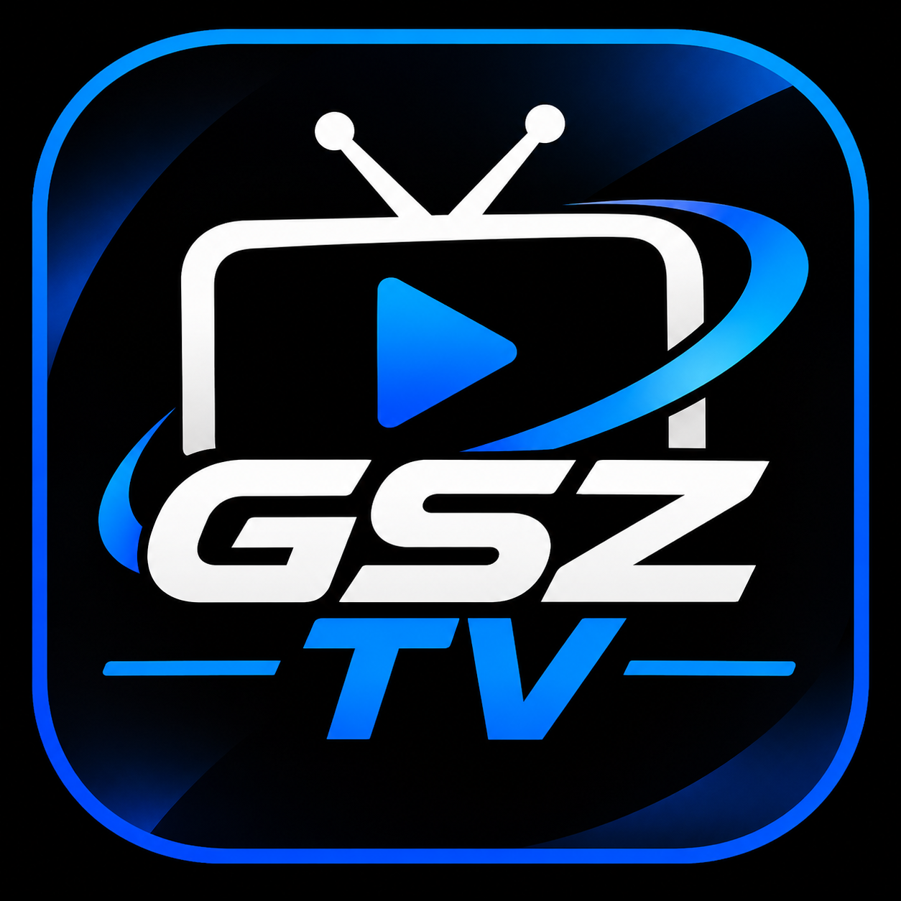
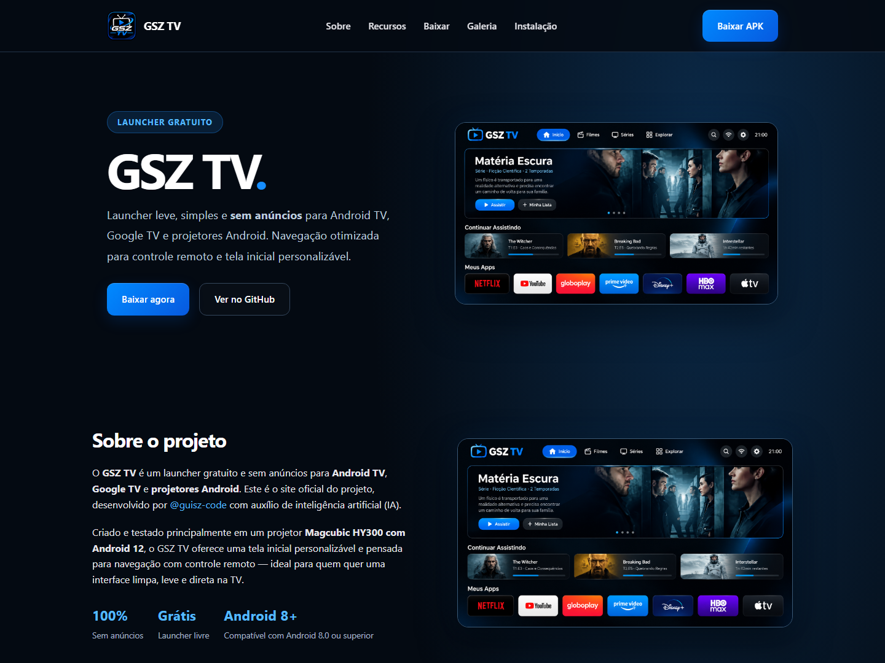

<h1 align="center">
   
  
   
  GSZ TV — Site Oficial
   
</h1>

  <strong>Site oficial do launcher GSZ TV.</strong>
  Tudo sobre o launcher gratuito, leve e sem anúncios para Android TV, Google TV e projetores Android.

  <a href="https://guisz-code.github.io/gzs-tv-site/" target="_blank"><strong>🌐 Acessar o site</strong></a> ·
  <a href="https://github.com/guisz-code/GSZ-TV/releases/latest" target="_blank"><strong>⬇️ Baixar APK</strong></a> ·
  <a href="https://github.com/guisz-code/GSZ-TV" target="_blank"><strong>📦 Repositório principal</strong></a>

---

---

## 🖼️ Preview do site

  

> Prévia do visual atual do site. Para atualizar esta imagem após alterações, capture a página inicial e substitua `assets/site-homepage-v2.png`.

---

## 📖 Sobre o site

Este é o **site oficial do GSZ TV**, desenvolvido com HTML e CSS puro, hospedado gratuitamente via **GitHub Pages**.

Aqui você encontra:

- 📺 **Sobre o projeto** — resumo do launcher GSZ TV, seus diferenciais e requisitos.
- ⚡ **Recursos** — interface para TV, leveza, personalização e atualizações.
- ⬇️ **Baixar** — link direto para o APK mais recente na página de Releases.
- 🖼️ **Galeria** — espaço reservado para fotos do launcher (em breve).
- 🔧 **Instalação** — passo a passo para instalar na TV/projetor ou via ADB.

---

## 🔗 Links rápidos

| Link | Para que serve |
|------|----------------|
| [🌐 Site Oficial](https://guisz-code.github.io/gzs-tv-site/) | Página principal com todas as informações |
| [⬇️ Baixar APK](https://github.com/guisz-code/GSZ-TV/releases/latest) | Versão mais recente do launcher |
| [📦 Repositório Principal](https://github.com/guisz-code/GSZ-TV) | Código-fonte do GSZ TV |
| [🐛 Reportar Problema](https://github.com/guisz-code/gzs-tv-site/issues) | Abra uma issue sobre o site |

---

## 🛠️ Tecnologias

- **HTML5** — estrutura da página
- **CSS3** — visual com tema azul neon, branco e preto
- **GitHub Pages** — hospedagem gratuita e automática

---

## 📄 Licença

Este projeto está licenciado sob a licença **MIT**. Veja o arquivo [LICENSE](https://github.com/guisz-code/GSZ-TV/blob/main/LICENSE) do repositório principal.

---

## 👨‍💻 Desenvolvedor

**GSZ TV — GSZ**  
GitHub: [@guisz-code](https://github.com/guisz-code)

---

  Feito com ❤️ para a comunidade Android TV

