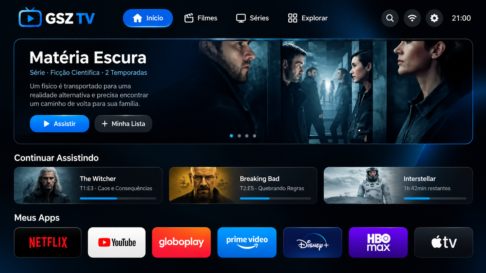

<h1 align="center">
   
  
   
  GSZ TV — Site Oficial
   
</h1>

  Launcher gratuito, leve e <strong>sem anúncios</strong> para Android TV, Google TV e projetores Android.

  <a href="https://guisz-code.github.io/gzs-tv-site/" target="_blank"><strong>🌐 Acessar Site</strong></a> ·
  <a href="https://github.com/guisz-code/GSZ-TV/releases/latest" target="_blank"><strong>⬇️ Baixar APK</strong></a> ·
  <a href="https://github.com/guisz-code/GSZ-TV" target="_blank"><strong>📦 Repositório Principal</strong></a>

---

---

## 📺 Sobre o Projeto

O **GSZ TV** é um launcher gratuito e sem anúncios para **Android TV**, **Google TV** e **projetores Android**. Este repositório contém o site oficial do projeto, desenvolvido com HTML e CSS puro, inspirado na identidade visual do launcher: **azul neon, branco e preto**.

O site apresenta:
- Resumo do projeto e seus recursos
- Galeria com espaço para fotos do launcher
- Passo a passo para baixar e instalar o APK
- Instruções de instalação via ADB

> 💡 O site é estático e hospedado gratuitamente via **GitHub Pages**.

---

## 🖼️ Preview

  

---

## 🚀 Recursos

- ✅ **Grátis e sem anúncios**
- ✅ **Interface otimizada para TV** (controle remoto)
- ✅ **Compatível com Android 8.0+**
- ✅ **Leve e rápido**
- ✅ **Tela inicial personalizável**
- ✅ **Atualizações via Releases**

---

## 🔗 Links Rápidos

| Link | Descrição |
|------|-----------|
| [🌐 Site Oficial](https://guisz-code.github.io/gzs-tv-site/) | Acesse o site hospedado no GitHub Pages |
| [⬇️ Última Versão (APK)](https://github.com/guisz-code/GSZ-TV/releases/latest) | Baixe o APK mais recente |
| [📦 Repositório Principal](https://github.com/guisz-code/GSZ-TV) | Código-fonte do launcher |
| [🐛 Reportar Problema](https://github.com/guisz-code/gzs-tv-site/issues) | Abra uma issue no site |

---

## 🛠️ Tecnologias

- [HTML5](https://developer.mozilla.org/pt-BR/docs/Web/Guide/HTML/HTML5)
- [CSS3](https://developer.mozilla.org/pt-BR/docs/Web/CSS)
- [GitHub Pages](https://pages.github.com/) (hospedagem gratuita)

---

## 📄 Licença

Este projeto está licenciado sob a licença **MIT**. Veja o arquivo [LICENSE](https://github.com/guisz-code/GSZ-TV/blob/main/LICENSE) do repositório principal.

---

## 👨‍💻 Desenvolvedor

**GSZ TV — GSZ**  
GitHub: [@guisz-code](https://github.com/guisz-code)

---

  Feito com ❤️ para a comunidade Android TV

